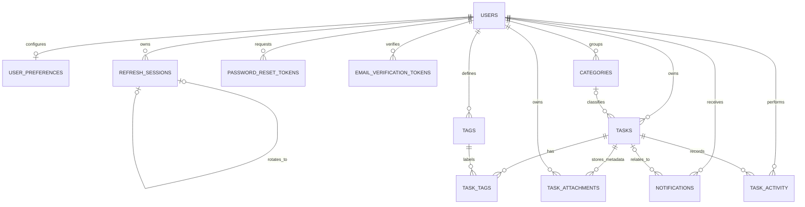
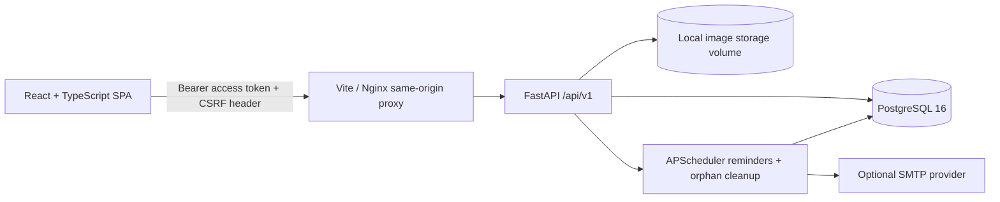

# TaskFlow

TaskFlow is a personal productivity workspace with a PostgreSQL database, FastAPI API, and React frontend.

## Quick Start

Prerequisites: Docker Compose, Python 3.12+, and Node.js 22+ with npm (for local frontend development). Copy `.env.example` to `.env`, replace the placeholder secrets, then run the full stack from the repository root:

```powershell
Copy-Item .env.example .env
docker compose up --build -d
```

Open the app at `http://localhost:5173`, API docs at `http://localhost:8000/docs`, and OpenAPI JSON at `http://localhost:8000/openapi.json`. Compose waits for the database, applies migrations once, and starts the backend and frontend after health checks.

## Database

PostgreSQL 16 is provided by Docker Compose. `db` is the development database (`taskflow` on port 5432); `db_test` is an isolated test database (`taskflow_test` on host port 5433). Tests reject any database whose name is not exactly `taskflow_test`.

All event timestamps use PostgreSQL `timestamptz` and are written in UTC. The application layer converts values to each user's configured IANA timezone for display and input. A task without `due_at` has no deadline and is never overdue. An active task is overdue when it has a deadline earlier than the current UTC instant; completed, archived, soft-deleted, and deadline-free tasks are not overdue. `reminder_offset_minutes` stores how many minutes before `due_at` a reminder should be scheduled; no reminder is implied when either value is null. Notification `dedupe_key`, unique per user when present, prevents duplicate reminder records.

Enums are native PostgreSQL enums for task status, task priority, and theme, giving these bounded domain values database-level type safety. Search uses PostgreSQL's built-in English full-text parser with a GIN index, so no extension install is needed.

### Database handoff names

Use these names as the backend contract. UUID `id` columns are primary keys unless noted; all timestamp columns use `timestamptz` and are UTC.

| Table | Columns |
|---|---|
| `users` | `id`, `full_name`, `email`, `phone_number`, `profile_picture_key`, `password_hash`, `is_active`, `is_verified`, `created_at`, `updated_at` |
| `user_preferences` | `user_id` (PK/FK), `theme`, `timezone`, `date_format`, `time_format`, `default_priority`, `accent_color`, `notify_in_app`, `notify_email`, `dashboard_preferences` |
| `refresh_sessions` | `id`, `user_id`, `token_hash`, `family_id`, `user_agent`, `ip`, `created_at`, `expires_at`, `revoked_at`, `replaced_by_id`, `remember_me` |
| `password_reset_tokens` | `id`, `user_id`, `token_hash`, `expires_at`, `used_at`, `created_at` |
| `email_verification_tokens` | `id`, `user_id`, `token_hash`, `new_email`, `expires_at`, `used_at`, `created_at` |
| `categories` | `id`, `user_id`, `name`, `color` |
| `tags` | `id`, `user_id`, `name` |
| `tasks` | `id`, `user_id`, `category_id`, `title`, `description`, `status`, `priority`, `start_at`, `due_at`, `is_all_day`, `estimated_duration_minutes`, `completed_at`, `external_url`, `reminder_offset_minutes`, `created_at`, `updated_at`, `deleted_at` |
| `task_tags` | `task_id` + `tag_id` (composite PK) |
| `task_attachments` | `id`, `task_id`, `user_id`, `storage_key`, `original_filename`, `content_type`, `size_bytes`, `checksum`, `created_at` |
| `notifications` | `id`, `user_id`, `task_id`, `type`, `title`, `body`, `is_read`, `created_at`, `dedupe_key` |
| `task_activity` | `id`, `task_id`, `user_id`, `action`, `changes`, `created_at` |

Enum type names and values: `theme` = `light`, `dark`, `system`; `task_status` = `pending`, `in_progress`, `completed`, `archived`; `task_priority` = `low`, `medium`, `high`, `urgent`.

### Database verification

After starting both databases and installing `backend` dependencies, run from `backend/`:

```powershell
python -m alembic upgrade head
python -m alembic downgrade base
python -m alembic upgrade head
python -m alembic check
python -m pytest
```

The pytest configuration overrides `DATABASE_URL` with `TEST_DATABASE_URL` and rejects any test database name other than `taskflow_test`. Migration round-trip and metadata drift checks are also part of the migration test. Latest local verification: `python -m ruff check .` and `python -m ruff format --check .` pass (33 files formatted); `python -m pytest -p no:cacheprovider --tb=short -q` reports 13 passed, 19 PostgreSQL-backed errors, and 1 migration-round-trip failure because `localhost:5433` is unavailable. Docker is not installed here, so rerun the migration commands and full suite after starting `db_test` with `docker compose up -d --wait db_test`. `pip-audit --local --skip-editable` reports no known dependency vulnerabilities; the editable project distribution is skipped by the tool.

### Relationships and deletion



Deleting a user cascades to preferences, sessions, reset/verification tokens, categories, tags, tasks, attachments, notifications, and activity. Deleting a category sets a task's `category_id` to null. Deleting a tag or task removes task-tag links; deleting a task also removes attachment metadata and activity, but files in external storage require separate cleanup. Deleting a task sets related notification `task_id` to null. Deleting a refresh session clears a session's `replaced_by_id` pointer.

### Indexes

- `users(email)` plus unique `lower(email)`: exact uniqueness and protection against case variants; application assignments are normalized too.
- Unique `lower(name)` indexes on categories and tags scoped by `user_id`: case-insensitive per-user names.
- Refresh-session `replaced_by_id`: efficient lookup and maintenance of the self-referential token-rotation link. `task_tags(tag_id)`: efficient reverse lookup of tasks by tag; the composite primary key already indexes `task_id` first.
- Task `(user_id, status)`, `(user_id, priority)`, `(user_id, due_at)`, `(user_id, deleted_at)`, and `(user_id, created_at)`: common filtered lists and ordered views.
- Partial `(user_id, due_at)` for non-deleted pending/in-progress tasks: compact active-task and reminder scans.
- Task `(user_id, category_id)`: category-filtered lists; attachment task/user and activity task/user indexes: efficient FK-related access and owner-scoped history.
- GIN `to_tsvector('english', concat_ws(' ', title, description))`: indexed full-text search over task title and description.
- Notifications `(user_id, is_read, created_at)`: unread and chronological inbox queries; task ID: related-notification lookup.
- Refresh-session token hash and `(user_id, expires_at)`: credential lookup and session expiry cleanup; reset/verification `(user_id, expires_at)`: user token lifecycle queries.
- Task activity `(task_id, created_at)` and `(user_id, created_at)`: task history and user activity timelines.

### Local commands

From the repository root, run `Copy-Item .env.example .env`, replace the placeholder secrets with local-only values, and start both databases with `docker compose up -d --wait db db_test`. Then:

```powershell
cd backend
python -m venv .venv
.\.venv\Scripts\Activate.ps1
python -m pip install -e ".[dev]"
python -m alembic upgrade head
python -m alembic downgrade base
python -m alembic upgrade head
python -m alembic check
python -m pytest
```

The test fixture loads `TEST_DATABASE_URL` from `.env`, overrides `DATABASE_URL` with it, and refuses to run unless its database name is `taskflow_test`. Never point test settings at the development database. The development-only seed is invoked from `backend/` with `python -m scripts.seed_dev`; it refuses `APP_ENV=production` and creates a disabled, non-login demo account with sample tasks.

## Backend API

### Start

For local Python development, start PostgreSQL first, then from `backend/` install dependencies and apply migrations as above. Start the API with:

```powershell
python -m uvicorn app.main:app --reload --host 127.0.0.1 --port 8000 --no-access-log
```

For Compose, run `docker compose up --build -d`. The `migrate` one-shot service applies Alembic revisions before the backend starts; the frontend waits for backend health. The backend container runs as UID 10001 and exposes `/health` and `/ready`. OpenAPI JSON is at `/openapi.json`; Swagger UI is `/docs` outside production. `APP_ENV=production` disables the docs UI and requires a non-placeholder JWT secret and SMTP host.

### API contract

All application paths use `/api/v1`. Errors use `{"error":{"code":"...","message":"..."}}`; validation errors also include safe `details` without submitted values. Private routes require `Authorization: Bearer <access_token>`. Ownership mismatches return 404.

| Method and path | Request | Response | Auth / common errors |
|---|---|---|---|
| `POST /auth/register` | `{full_name,email,password}` | 201 `{user,verification_required}` | Public; 409 duplicate, 422 policy; 5/min |
| `POST /auth/login` | `{email,password,remember_me?}` | `{access_token,token_type,expires_in,user}` plus cookies | Public; 401 credentials/disabled/unverified; 5/min |
| `POST /auth/refresh` | No body; refresh cookie and `X-CSRF-Token` | New access-token object and rotated cookies | CSRF; 401 invalid/expired/reuse; 30/min |
| `POST /auth/logout` | No body; refresh cookie and `X-CSRF-Token` | 204 | CSRF; idempotent |
| `POST /auth/forgot-password` | `{email}` | Generic `{message}` whether account exists or not | Public; 3/min |
| `POST /auth/reset-password` | `{token,new_password}` | `{message}` | Public; 400 invalid/expired/used, 422 weak password; 5/min |
| `POST /auth/email-verification/request` | No body | `{message}` | Bearer; 404 when `EMAIL_VERIFICATION_ENABLED=false` |
| `POST /auth/email-verification/confirm` | `{token}` | `{message}` | Public; 404 disabled, 400 invalid/expired/used |
| `GET /users/me` | None | User object without password hash | Bearer |
| `GET /users/me/preferences` | None | Preference object | Bearer |
| `PATCH /users/me` | `{full_name?,phone_number?}` | User object | Bearer; other fields ignored/rejected by schema |
| `PATCH /users/me/preferences` | Allowlisted theme/timezone/date/time/priority/accent/notification/dashboard fields | Preference object | Bearer; 422 invalid database enum/check values |
| `POST /users/me/change-password` | `{current_password,new_password}` | `{message}` | Bearer; 400 current password mismatch; revokes sessions |
| `DELETE /users/me` | None | 204 | Bearer; cascades account-owned records |
| `GET /users/me/export` | None | JSON of current user's profile, preferences, tasks, categories, tags, attachments, activity, notifications | Bearer |
| `GET /users/me/sessions` | None | Array of active session metadata | Bearer |
| `DELETE /users/me/sessions/{session_id}` | None | 204 | Bearer; 404 not owned/not found |
| `POST /users/me/email` | `{email}` | 202 generic message | Bearer; 404 when verification disabled |
| `GET /users/me/categories`, `GET /users/me/tags` | None | Arrays | Bearer |
| `POST /users/me/categories` | `{name,color?}` | 201 category | Bearer; 409 duplicate per-user name |
| `PATCH /users/me/categories/{id}` | `{name?,color?}` | Category | Bearer; 404/409 |
| `DELETE /users/me/categories/{id}` | None | 204 | Bearer; tasks retain null category |
| `POST /users/me/tags` | `{name}` | 201 tag | Bearer; 409 duplicate per-user name |
| `PATCH /users/me/tags/{id}` | `{name}` | Tag | Bearer; 404/409 |
| `DELETE /users/me/tags/{id}` | None | 204 | Bearer |
| `GET /tasks` | Query: `search,status[]`, `priority`, `category_id`, `tag_id`, `due_from`, `due_to`, `overdue`, `include_archived`, `sort`, `order`, `limit` (1-100), `offset` | `{items,total,limit,offset}` | Bearer; sort `due_at,priority,created_at,title`; order `asc,desc`; status `pending,in_progress,completed,archived` |
| `POST /tasks` | `{title,description?,status?,priority?,category_id?,tag_ids?,start_at?,due_at?,is_all_day?,estimated_duration_minutes?,external_url?,reminder_offset_minutes?}` | 201 Task | Bearer; 404 foreign category/tag, 422 invalid title/interval/url |
| `GET /tasks/{id}` | None | Task including `tag_ids` | Bearer; 404 missing, deleted, or foreign |
| `PATCH /tasks/{id}` | `{expected_updated_at,title?,description?,priority?,category_id?,tag_ids?,start_at?,due_at?,is_all_day?,estimated_duration_minutes?,external_url?,reminder_offset_minutes?}` | Task | Bearer; 409 concurrency conflict; 404/422 |
| `POST /tasks/{id}/complete`, `POST /tasks/{id}/reopen` | None | Task | Bearer; idempotent; complete sets UTC `completed_at`, reopen clears it |
| `POST /tasks/{id}/duplicate` | None | 201 Task | Bearer; 404 |
| `POST /tasks/bulk-complete`, `POST /tasks/bulk-delete` | `{ids:[UUID,...]}` (1-100) | `{updated,items}` or `{deleted}` | Bearer; only owned, non-deleted matches are affected |
| `POST /tasks/{id}/archive`, `DELETE /tasks/{id}` | None | Task or 204 | Bearer; delete is soft-delete |
| `GET /tasks/trash`, `POST /tasks/{id}/restore` | Trash query `limit,offset`; restore has no body | Task array or restored Task | Bearer |
| `GET /tasks/{id}/activity` | None | Activity array | Bearer; 404 foreign/missing task |
| `GET /tasks/calendar/events` | `start,end` timezone-aware datetimes | Task array, including all-day marker | Bearer; 422 invalid range |
| `GET /dashboard/summary` | None | Counts: `total,completed,pending,in_progress,overdue,due_today,high_or_urgent,completion_percent` | Bearer; scoped SQL aggregate |
| `GET /dashboard/productivity` | `days=7` or `30` | `{days:[{date,completed}]}` in user's timezone | Bearer |
| `GET /dashboard/status-distribution` | None | Status-to-count object; archived excluded | Bearer |
| `GET /dashboard/upcoming` | `days` 1-90, `limit` 1-50 | Task array | Bearer |
| `GET /dashboard/recent` | `limit` 1-50 | Task array | Bearer |
| `GET /notifications` | `unread_only`, `limit` 1-100, `offset` | Notification array | Bearer |
| `GET /notifications/unread-count` | None | `{count}` | Bearer |
| `POST /notifications/{id}/read`, `POST /notifications/read-all` | None | Notification or `{updated}` | Bearer; foreign notification returns 404 |
| `POST /users/me/profile-picture`, `POST /tasks/{id}/attachments` | Multipart `file` | Profile key/content type or 201 attachment metadata | Bearer; JPEG/PNG/WebP only; 413 too large, 415 invalid image |
| `GET /tasks/{id}/attachments` | None | Attachment metadata array | Bearer; task ownership checked |
| `GET /users/me/profile-picture`, `GET /attachments/{id}` | None | Authorized image bytes | Bearer; `nosniff`; 404 missing/foreign |
| `DELETE /users/me/profile-picture`, `DELETE /attachments/{id}` | None | 204 | Bearer |

Task status values are `pending`, `in_progress`, `completed`, `archived`; priorities are `low`, `medium`, `high`, `urgent`. Theme values are `light`, `dark`, `system`. Passwords must be at least 12 characters and include uppercase, lowercase, a digit, and a symbol. Task times must be timezone-aware; external URLs accept only `http` or `https`.

### Frontend authentication flow

1. Send login/register JSON to `/api/v1/auth/login` (registration creates an account; login establishes the session). Keep `access_token` only in JavaScript memory and send it as `Authorization: Bearer ...` on private API calls.
2. Send requests with `credentials: "include"` so the browser stores the Secure/HttpOnly `refresh_token` cookie and readable `csrf_token` cookie. The refresh cookie is HttpOnly; JavaScript must never read or persist it.
3. On `POST /api/v1/auth/refresh` and `POST /api/v1/auth/logout`, read `csrf_token` and copy its value to `X-CSRF-Token`. Refresh rotates both cookies and returns a new access token.
4. On an API 401, attempt refresh once, retry the original request once if refresh succeeds, otherwise clear in-memory auth state and show sign-in. Reuse of a rotated refresh token revokes its entire family.

Email verification is **disabled by default**. When enabled, registration/login verification requirements apply and SMTP credentials should be configured. Development without SMTP prints mail contents to the console; production never includes reset/verification tokens in responses or logs. Password reset responses are generic. The reminder scheduler runs every 30 seconds independently of browser activity; it uses row locking and the unique `(user_id,dedupe_key)` constraint to tolerate multiple API processes. Email reminders are sent only when the user preference is enabled and SMTP is configured.

### Security checklist and limits

- Argon2id password hashes; short-lived HS256 access JWTs validated for signature, `exp`, issuer, and audience; opaque refresh/reset/verification tokens stored only as SHA-256 hashes.
- Refresh rotation and family reuse revocation; CSRF double-submit cookie/header (`X-CSRF-Token`) on cookie-authenticated mutation routes.
- Per-user ownership filters for tasks, categories, tags, sessions, notifications, attachments, and exports; unknown/foreign IDs return 404.
- Allowlisted profile/task/catalog fields, parameterized SQL, fixed sort expressions, Pydantic validation, request and upload size limits, and re-encoded image-only uploads.
- CORS origins are configured by `CORS_ORIGINS`; production requires a non-placeholder JWT secret, sets secure cookies, disables interactive docs, and enables HSTS.
- Structured logs exclude request bodies, credentials, tokens, and email; validation error details omit submitted input values.

Run `python -m ruff check .`, `python -m ruff format --check .`, `python -m pip_audit`, and `python -m pytest` from `backend/`. PostgreSQL integration tests must use only `taskflow_test`. S3-compatible storage is an explicit unimplemented adapter; current uploads use local filesystem storage. Reminder email supports configured SMTP; no provider-specific delivery guarantees are made.

## Frontend

The React 19, TypeScript, Vite app uses React Router, TanStack Query, Axios, React Hook Form/Zod, Tailwind CSS, Lucide, Recharts, and Sonner. It consumes the real `/api/v1` endpoints above; there are no production mock responses. The API client keeps access tokens in module memory, uses the refresh cookie and double-submit CSRF header, and retries one unauthorized request after a single shared refresh. The same-origin `/api/` proxy is provided by Vite during local development and Nginx in Compose.

Local frontend development requires Node.js 22 and npm:

```powershell
cd frontend
Copy-Item .env.example .env
npm ci
npm run dev
```

Open `http://localhost:5173`. With the API on port 8000, Vite proxies `/api` to it. Full-stack Compose publishes the frontend on port 5173, API on 8000, PostgreSQL on 5432, and isolated test PostgreSQL on 5433.

## Architecture



## Project Layout

```text
backend/app/api/endpoints/   FastAPI route modules
backend/app/core/            Settings, JWT/password security, middleware, rate limits
backend/app/db/              Existing SQLAlchemy models/session/base
backend/app/services/        Reminder scheduler and background logic
backend/app/storage/         Image sanitation and local/S3 storage interfaces
backend/alembic/             Explicit database migrations
backend/tests/               Isolated PostgreSQL and HTTPX tests
frontend/src/app/             Providers and React Router
frontend/src/components/      Layout, task workflows, accessible primitives
frontend/src/pages/           Public, dashboard, tasks, calendar, profile, settings
frontend/src/services/        Centralized Axios API client
frontend/e2e/                 Playwright full-stack scenarios
```

## Environment

Root `.env.example` contains the PostgreSQL connection/user values, `APP_ENV`, JWT key/issuer/audience, access/refresh lifetimes, `CORS_ORIGINS`, verification and cookie settings, upload/request limits, scheduler toggle, optional SMTP settings, and `FRONTEND_BASE_URL` used in password reset links. Replace placeholders locally; never commit `.env`. `frontend/.env.example` contains `VITE_API_BASE_URL` and `VITE_API_PROXY`. Compose uses `/api/v1` and proxies to the backend service internally.

## Quality Commands

From `backend/`:

```powershell
python -m ruff check .
python -m ruff format --check .
python -m pip_audit --local --skip-editable
python -m pytest
```

From `frontend/` after `npm ci`:

```powershell
npm run typecheck
npm run lint
npm run format:check
npm test
npm run build
npm audit
npm run e2e
```

The database tests require only the isolated `taskflow_test` database on port 5433. Playwright requires the full Compose stack and browser binaries (`npx playwright install chromium`).

## Security and Troubleshooting

- Do not run integration tests against the development database. The test fixture validates the database name and adds a short connection timeout so a missing test service fails quickly.
- If readiness fails, inspect `docker compose ps` and `docker compose logs db migrate backend`; the API waits for a healthy database and completed migration job.
- If the browser cannot reach the API locally, ensure the backend listens on port 8000 and `VITE_API_PROXY` is set to `http://localhost:8000`.
- Production requires a unique JWT secret, HTTPS with Secure cookies, an SMTP host for account email, configured CORS origins, and operator-managed backups/retention. Never expose the refresh token to JavaScript.
- Email verification defaults to disabled; no verification capability should be assumed unless `EMAIL_VERIFICATION_ENABLED=true` and SMTP is configured.
- Attachments are sanitized raster images. SVG is rejected. S3-compatible storage is not implemented.

## Delivery Status

| Area | Status | Notes |
|---|---|---|
| Database schema and explicit migrations | Implemented | Real online migration round-trip still requires PostgreSQL availability. |
| Auth, sessions, task/catalog/dashboard/notification API | Implemented | Database-backed API integration coverage is present but cannot pass without `taskflow_test`. |
| API layering | Partial | Schemas hold request validation and endpoint modules own routing, but several endpoint modules still contain business logic and direct SQL; full service/repository extraction remains. |
| React application and API-backed core workflows | Implemented in source | The UI uses a project-specific accessible primitive set. Typecheck, unit tests, lint, formatting, build, and dependency audit have been run; the Playwright browser run is blocked because this environment has no Docker stack or Playwright browser binaries. |
| Local image storage and cleanup | Implemented | Uses filesystem volume; remote S3-compatible adapter intentionally throws not-implemented errors. |
| Email verification | Feature-flagged, disabled by default | SMTP must be configured; development mail is console output. |
| Email reminders | Optional | SMTP and per-user email preference required. |
| Full legal review, production privacy contact, retention policy | Deferred to deployer | Current Privacy/Terms pages describe technical behavior and explicitly note missing operator/legal details. |
| Playwright E2E and axe checks at desktop, tablet, and mobile widths | Implemented, execution blocked | The configured flows cover registration, task lifecycle, attachment and owner isolation at three viewports, with axe checks on signup, dashboard, and task details. Execution needs the Compose stack and `npx playwright install chromium`; neither Docker nor browser binaries are available in this environment. |
| Exhaustive attack/rate-limit test matrix | Deferred | Current backend tests cover representative security and rate-limit cases; a broader fuzzing and penetration-test program remains deployment work. |
